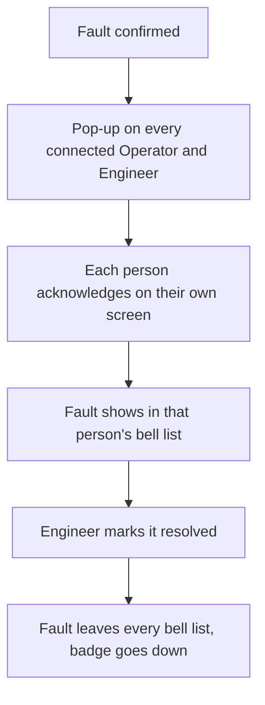

# 4. Machine detail

Back to [[page-map]]. Previous: [[03-machines-list]]. Next: [[05-settings]].

One page for one machine. It opens the same way from three places:
- a card on the [[02-overview]],
- a row in the [[03-machines-list]],
- a fault in the bell list or a fault pop-up (see [[top-bar]] and [[fault-popup]]).

Supports steps 3 and 4 of [[UC-1]] and the report steps of [[UC-3]].

## Layout

```
+------------------------------------------------------------+
| (top bar)                                                  |
+------------------------------------------------------------+
| < Overview     Motor 1     [ WARNING ]   [ MAINTENANCE ]   |
|                          Maintenance [ on | off ]  Engineer |
+------------------------------------------------------------+
| LIVE READINGS AND STATUS                                   |
| +-----------+ +-----------+ +-----------+ +-----------+    |
| | Temp      | | Current   | | Vibration | | RPM       |    |
| | 81 C      | | 4.0 A     | | high      | | 1475      |    |
| | [WARNING] | | [NORMAL]  | | [WARNING] | | [NORMAL]  |    |
| +-----------+ +-----------+ +-----------+ +-----------+    |
|                                                            |
| GRAPH            [ Day ] [ Week ] [ Month ] [ Year ]       |
| Temp   ~~~~/\~~~~~~~/``\_____                              |
| Current ~~~~~~~~~~~~~~~~~~~~~                              |
| Vibration ~~~~~~~~/`\~~~~~~~                               |
| RPM    ~~~~~~~~~~~~~~~~~~~~~                               |
|                                    [ Generate report ]     |
|                                                            |
| HISTORY AND FAULTS                                         |
| Parameter | Type | Level   | Time  | Acknowledged by | Resolved |
| Temp      | high | Warning | 10:42 | Operator A      | [ off ]  |
| Vibration | high | Warning | 10:42 | Operator A, Eng B | [ on ] |
+------------------------------------------------------------+
```

The same layout is used for a motor, a water pump and a backup power unit. Only the readings change.

## Parts of the page

| Part | What it does | Requirement |
| --- | --- | --- |
| Header | Machine name, status, and a "Maintenance" mark while it is in maintenance mode. | [[FR-5]], [[FR-18]] |
| Live readings, motor | Temperature, current, vibration, speed (RPM). | [[FR-1]] |
| Live readings, water pump | Bearing temperature, current, vibration, speed (RPM). | [[FR-2]] |
| Live readings, backup power | Internal temperature, charging or output current, cooling fan speed. | [[FR-3]] |
| Status on each reading | Each parameter has its own status word. | [[FR-5]] |
| "Sensor fault" and "Invalid" marks | Same marks as the overview. | [[FR-13]], [[FR-14]] |
| Graph with Day, Week, Month, Year | One line graph for each parameter over the chosen period. | [[FR-9]] |
| Generate report | Makes a report of this machine's performance and recurring faults for the chosen period. Operator and Engineer. | [[FR-10]], [[UC-3]] |
| History and faults | Every fault of this machine. A fault on two parameters at once is two lines. Shows who acknowledged each one. | [[FR-9]], [[FR-15]], [[FR-8a]] |
| No repeat alerts | A fault that is already open does not appear again as a new line. | [[FR-16]] |
| Maintenance switch | Engineer only. Asks for how long, then turns maintenance mode on. Readings keep coming, new fault alerts pause. | [[FR-18]], [[FR-19]] |
| Resolved switch | Engineer only, on each fault. Marks the fault resolved and records when. | [[FR-17]] |

## The life of a fault (new decision)



- An Operator acknowledging does not count for the Engineer. The Engineer has to acknowledge too ([[srs-changes]], change 1).
- The Engineer has to have acknowledged before resolving ([[FR-17]]).
- Acknowledging never closes the fault. Only resolving does ([[FR-8b]]).

## What the graph can show

- Every 10 seconds the system keeps one status with its time ([[FR-9a]]).
- The readings of a normal period are deleted after 24 hours. The readings of a warning or critical period are kept with their status ([[FR-9b]]).
- So the Day graph can show full readings. Week, Month and Year show status over time, and full readings only around faults.
- A newly registered machine has no history yet. The page shows the live readings and a line saying history will build up ([[UC-1]] step 4a).
- If the chosen period holds no faults, the page says so. If it holds no data at all, the page explains why no report can be made ([[UC-3]] steps 2a and 3a).

## Who can do what

| Action | Operator | Engineer |
| --- | --- | --- |
| See live readings, graph, history | yes | yes |
| Generate a report | yes | yes |
| Acknowledge a fault | yes | yes |
| Resolve a fault | no | yes |
| Turn maintenance on or off | no | yes |

## Open

- Whether the Administrator can open this page from an overview card is not decided.
- You wrote "toggle" for resolved and for maintenance. The SRS has no way to un-resolve a fault. Can a resolved fault be switched back to open?
- Maintenance mode needs a stated duration ([[FR-18]]). The switch will ask for it.
- Operators and Engineers can both generate reports. Maintenance and resolving stay Engineer only, as in the SRS. Say so if the Operator should have them.
