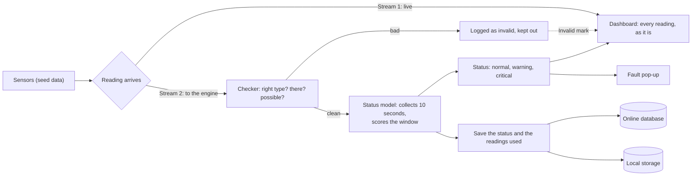

# Engine: how a reading travels

Back to [[page-map]].

Every reading is split into two streams the moment it arrives. One goes straight to the dashboard. The other goes to the engine.

## The steps

| Step | What happens | Requirement |
| --- | --- | --- |
| Reading arrives | One reading per second, for every parameter of every machine. | [[FR-3a]], [[PR-005]] |
| Stream 1, live | The dashboard shows each reading within 2 seconds, even a wrong one. | [[PR-002]] |
| Checker | A wrong type, a missing value or an impossible number is rejected, logged as invalid and kept out of the status model. The system carries on. | [[FR-14]], [[NFR-7]] |
| Status model | Collects 10 seconds of clean readings and gives the window a fault score from 0 to 100%. At 50% or more the window is flagged. One abnormal reading alone does not reach it. See below. | [[FR-6]], [[PR-001]] |
| Status | Normal, warning or critical, with the machine and parameter named. | [[FR-5]] |
| Pop-up | A confirmed fault shows on every connected Operator and Engineer screen. | [[FR-7]], [[PR-001a]] |
| Save | After each 10-second window, the status and time are stored. Readings of a warning or critical window are kept with it. | [[FR-9a]], [[FR-9b]] |
| Two stores | The same data is written to the online database and to local storage at the same time. | [[NFR-6]], [[FR-12]], [[FR-20]] |

## How a window is scored

1. **Screening.** Each reading is compared with the limits of its machine and parameter and marked normal, warning, critical (or abnormal, for a parameter with one level). A limit that is not set is not used. [[FR-4]]
2. **Four numbers describe the window:** the share of readings at the first level or above, the share at critical, and the lowest and highest level seen.
3. **The model scores it.** A logistic regression, trained on a labelled set made from seed data (Appendix D), turns those numbers into two scores: the chance the window is at least a first-level fault, and the chance it is critical. [[FR-5]], [[FR-6]]
4. **The cut-off.** A first-level score of 50% or more flags the window (`STATUS_PROBABILITY`). Critical needs its own score of 50% or more, and only a parameter with a critical limit can be critical.
5. **A steady swing** (pump speed) can make a window abnormal on its own, when the typical step between readings is more than 6% of the mean, even if no reading crosses a limit.
6. **Without scikit-learn** the score is the share of readings over a limit.
7. **On screen,** the live window card shows the readings of the window now, then the last closed window with its status and its fault score.

How the labelled windows are made: a window with *f* of its 10 readings over a limit is labelled a fault when *f* ÷ 10 is at least 60% (`TREND_FRACTION`); otherwise normal. Measured scores for motor temperature, warning limit 130 °C:

| Readings over the limit (of 10) | Fault score | Status |
| --- | --- | --- |
| 10 | 100% | warning |
| 8 | 95% | warning |
| 7 | 83% | warning |
| 6 | 56% | warning |
| 5 | 25% | normal |
| 1 (a spike) | 0% | normal |
| 9 critical and 1 normal | critical 95% | critical |

## Known gaps

- **Short windows.** A window with fewer than 10 readings is scored on what arrived. After maintenance ends, after a reconnect, or when readings are lost, one to three readings over a limit score 100% and flag the window. [[FR-6]] says a single abnormal reading never makes a fault. *Suggested guard:* only flag a window with at least 8 clean readings. Not built.
- **Time to flag.** Windows are fixed 10-second blocks, and the status is set when the block ends. A fault that starts early in a block is flagged at its end (up to 10 seconds later). One that starts late in a block is flagged at the end of the next one, up to about 16 seconds after it began. [[PR-001]] only asks for a status every 10 seconds. A sliding window would be faster and is not planned.
- **The 100% result.** The labelled test set ([[NFR-1]], [[NFR-2]]) comes from the same generator as the training set, so 100% shows that the model learned the labels. It does not show the model is right on real sensor data.

## Proposed, not decided

- **Online database:** PostgreSQL.
- **Local storage:** SQLite, one file next to the Flask server.
- **Cut connection (demo):** the button stops Flask reaching the online database. The local file keeps everything, and the missing readings are copied across when the link returns.

## Open

- Does the dashboard get the status straight from the model, or after it is saved? The diagram shows it straight from the model.
