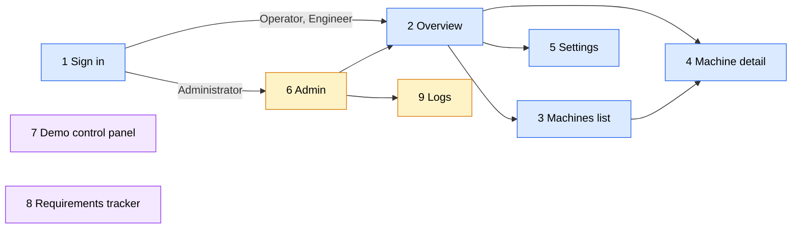

# Page map

The pages of the dashboard, who uses each one, and which requirements each page covers. Requirement numbers are those of SRS v2.0 (branch `v1.7-clear-statements`).

FR = functional requirement. UC = use case. DC = design constraint.

## Roles (SRS v2.0)

| Role | What they do |
| --- | --- |
| Operator | Watches the machines. Gets fault pop-ups. Acknowledges faults. |
| Engineer | Everything the Operator does, plus resolves faults, uses maintenance mode and changes limits. |
| Administrator | Manages users, machines, settings and storage. Sees the Overview and reads the Logs. Gets the storage alert only. No fault alerts. Does not acknowledge. |

## Pages

| # | Page | Who uses it | What it does | Covers |
| --- | --- | --- | --- | --- |
| 1 | [[01-sign-in]] | everyone | Login. Automatic sign-out after 5 minutes idle. Lockout after 5 wrong attempts. | [[FR-26]], [[FR-28]], [[FR-28a]] to [[FR-28f]] |
| 2 | [[02-overview]] | Operator, Engineer, Administrator | Status of every machine at a glance. Live readings. Marks for "sensor stopped" and "invalid reading". | [[UC-1]], [[FR-1]] to [[FR-3]], [[FR-3a]], [[FR-13]], [[FR-14]], [[FR-24]] |
| 3 | [[03-machines-list]] | Operator, Engineer | Every machine in a list, with a filter. Choosing one opens its page. | [[FR-24]], [[FR-5]], [[FR-18]] |
| 4 | [[04-machine-detail]] | Operator, Engineer | One machine: readings, recent history, faults. One fault record per abnormal parameter. | [[UC-1]], [[FR-1]] to [[FR-3]], [[FR-15]] |
| 5 | [[05-settings]] | everyone (limits: Engineer) | Theme, sign-out time, change password, and limits for Engineers. Each machine has its own limits, and any of the four limits can be left out ("not necessary"). | [[FR-26]], [[FR-23]], [[FR-23a]] to [[FR-23d]] |
| 6 | [[06-admin]] | Administrator | Three tabs: Users, Machines, Storage, and a link to the Logs page. Storage alert at 75%. | [[UC-5]], [[FR-21a]], [[FR-22]], [[FR-27]], [[FR-28c]] |
| 7 | [[07-demo-control-panel]] | demonstration only | Switch Auto, Bluetooth or Wi-Fi mode. Put the work Bluetooth in or out of range. Cut the connection. Inject faults. | [[FR-11]], [[FR-12]], [[UC-4]], DC-006 |
| 8 | [[08-requirements-tracker]] | demonstration only | Every requirement, which page shows it, and whether it is built, simulated or left out. | all |
| 9 | [[09-logs]] | Administrator | Who did what and when, in plain sentences: limit changes, faults acknowledged and resolved, users and machines. Saved in the database. | [[FR-22]], [[FR-23]], [[FR-8a]] |

## Folded in

Three things were planned as pages of their own and are now part of other pages. They have no number.

| What | Now lives in | Covers |
| --- | --- | --- |
| Fault alerts and acknowledging | the bell list in [[top-bar]] and the [[fault-popup]] | [[UC-2]], [[FR-7]], [[FR-8]], [[FR-16]], [[FR-17]] |
| Graph, history and report | [[04-machine-detail]] | [[UC-3]], [[FR-9]], [[FR-10]] |
| Maintenance mode | [[04-machine-detail]] (maintenance switch) | [[UC-6]], [[FR-18]], [[FR-19]] |

## How the pages connect (proposed)

Blue: shared pages. Yellow: Administrator. Settings opens from the name side bar on any page. The three merged pages are listed under Folded in. Purple: demonstration only. The arrows are a proposal, not a requirement.

## Rules for every page

- Every page after sign in carries the same top bar and name side bar. See [[top-bar]].
- The top bar carries a Bluetooth icon and a Wi-Fi icon. The link in use glows blue and a link that is not there is grey. See [[top-bar]] and change 11 in [[srs-changes]].
- Every feature on screen carries a small tag with its requirement number, for example `FR-7`.
- The tracker page lists all requirements and marks each one:
  - **Built**: works in the demo.
  - **Simulated**: the demo imitates it.
  - **Left out**: not covered.
- Fault pop-ups stay until the person acknowledges them, and they show one at a time (critical first, then the oldest) with a count of how many are waiting. See [[fault-popup]]. They only reach Operators and Engineers ([[FR-7]], [[FR-7b]]).
- Every page uses the same look: compact cards, rounded corners, the Inter font. See [[visual-style]].
- The storage alert only reaches the Administrator ([[FR-21a]]).

## Demo scope for now

The demonstration registers two machines, **Motor 1** and **Motor 2**. Pumps and backup power units come back when they are registered (Administrator, Machines tab), and the demo buttons for a machine type that is not registered are hidden. Nothing in the requirements changes. The page designs still cover all three machine types.

## Not covered by any page

These requirements work behind the screens, so no page shows them. They still need a line in the tracker:

FR-4, FR-5, FR-6, FR-20, FR-21, FR-25. How a reading becomes a status is in [[engine]].

## Open

- Decisions that change the SRS are collected in [[srs-changes]].

- The Administrator sees the Overview, with no fault pop-ups and no bell list. Decided, see change 9 in [[srs-changes]].
- All nine page notes are written. The page numbers follow the order a person uses the pages.
