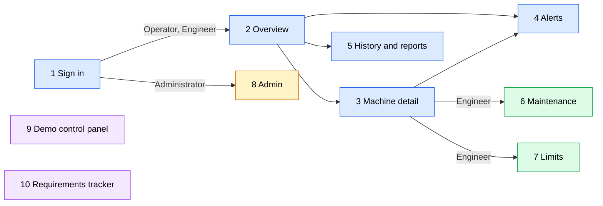

# Page map

The pages of the dashboard, who uses each one, and which requirements each page covers. Requirement numbers are those of SRS v2.0 (branch `v1.7-clear-statements`).

FR = functional requirement. UC = use case. DC = design constraint.

## Roles (SRS v2.0)

| Role | What they do |
| --- | --- |
| Operator | Watches the machines. Gets fault pop-ups. Acknowledges faults. |
| Engineer | Everything the Operator does, plus resolves faults, uses maintenance mode and changes limits. |
| Administrator | Manages users, machines, settings and storage. Gets the storage alert only. No fault alerts. Does not acknowledge. |

## Pages

| # | Page | Who uses it | What it does | Covers |
| --- | --- | --- | --- | --- |
| 1 | [[01-sign-in]] | everyone | Login. Automatic sign-out after 5 minutes idle. Lockout after 5 wrong attempts. | [[FR-26]], [[FR-28]], [[FR-28a]] to [[FR-28f]] |
| 2 | [[02-overview]] | Operator, Engineer | Status of every machine at a glance. Live readings. Marks for "sensor stopped" and "invalid reading". | [[UC-1]], [[FR-1]] to [[FR-3]], [[FR-3a]], [[FR-13]], [[FR-14]], [[FR-24]] |
| 3 | [[03-machine-detail]] | Operator, Engineer | One machine: readings, recent history, faults. One fault record per abnormal parameter. | [[UC-1]], [[FR-1]] to [[FR-3]], [[FR-15]] |
| 4 | [[04-alerts]] | Operator, Engineer | Pop-ups for connected users. Alert list. Operator acknowledges. Engineer also resolves. No duplicate alerts. | [[UC-2]], [[FR-7]], [[FR-7a]] to [[FR-7c]], [[FR-8]], [[FR-8a]], [[FR-8b]], [[FR-16]], [[FR-17]] |
| 5 | [[05-history-and-reports]] | all view; Operator and Engineer make reports | Past faults and reports. | [[UC-3]], [[FR-9]], [[FR-9a]], [[FR-9b]], [[FR-10]] |
| 6 | [[06-maintenance]] | Engineer | Pause alerts for a set time. Overdue flag. | [[UC-6]], [[FR-18]], [[FR-19]] |
| 7 | [[07-limits]] | Engineer | Change warning and critical limits. Old values kept. Applies to later readings. | [[FR-23]], [[FR-23a]] to [[FR-23d]] |
| 8 | [[08-admin]] | Administrator | Users, machines, change log. Storage alert at 75%. | [[UC-5]], [[FR-21a]], [[FR-22]], [[FR-27]] |
| 9 | [[09-demo-control-panel]] | demonstration only | Switch near or remote mode. Cut the connection. Inject faults. | [[FR-11]], [[FR-12]], [[UC-4]], DC-006 |
| 10 | [[10-requirements-tracker]] | demonstration only | Every requirement, which page shows it, and whether it is built, simulated or left out. | all |

## How the pages connect (proposed)

Blue: Operator and Engineer. Green: Engineer only. Yellow: Administrator. Purple: demonstration only. The arrows are a proposal, not a requirement.

## Rules for every page

- Every feature on screen carries a small tag with its requirement number, for example `FR-7`.
- The tracker page lists all requirements and marks each one:
  - **Built**: works in the demo.
  - **Simulated**: the demo imitates it.
  - **Left out**: not covered.
- Fault pop-ups only reach Operators and Engineers ([[FR-7]], [[FR-7b]]).
- The storage alert only reaches the Administrator ([[FR-21a]]).

## Not covered by any page

These requirements work behind the screens, so no page shows them. They still need a line in the tracker:

FR-4, FR-5, FR-6, FR-20, FR-21, FR-25.

## Open

- Does the Administrator also need to see the Overview page? Not included for now.
- Page notes `01` to `10` are not written yet. Each one will hold the screen layout and the use case steps it supports.
