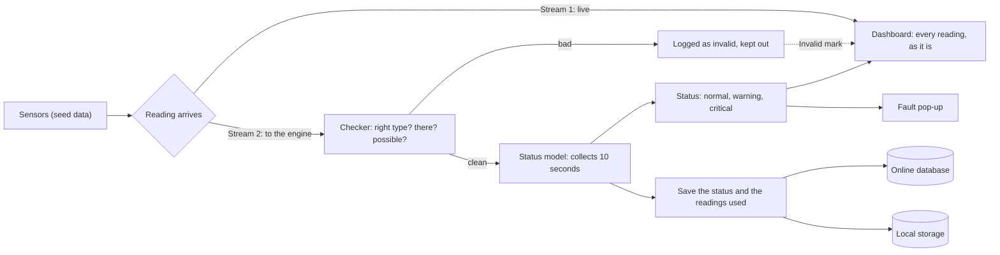

# Engine: how a reading travels

Back to [[page-map]].

Every reading is split into two streams the moment it arrives. One goes straight to the dashboard. The other goes to the engine.

## The steps

| Step | What happens | Requirement |
| --- | --- | --- |
| Reading arrives | One reading per second, for every parameter of every machine. | [[FR-3a]], [[PR-005]] |
| Stream 1, live | The dashboard shows each reading within 2 seconds, even a wrong one. | [[PR-002]] |
| Checker | A wrong type, a missing value or an impossible number is rejected, logged as invalid and kept out of the status model. The system carries on. | [[FR-14]], [[NFR-7]] |
| Status model | Collects 10 seconds of clean readings. One abnormal reading alone never raises a fault. | [[FR-6]], [[PR-001]] |
| Status | Normal, warning or critical, with the machine and parameter named. | [[FR-5]] |
| Pop-up | A confirmed fault shows on every connected Operator and Engineer screen. | [[FR-7]], [[PR-001a]] |
| Save | After each 10-second window, the status and time are stored. Readings of a warning or critical window are kept with it. | [[FR-9a]], [[FR-9b]] |
| Two stores | The same data is written to the online database and to local storage at the same time. | [[NFR-6]], [[FR-12]], [[FR-20]] |

## Proposed, not decided

- **Online database:** PostgreSQL.
- **Local storage:** SQLite, one file next to the Flask server.
- **Cut connection (demo):** the button stops Flask reaching the online database. The local file keeps everything, and the missing readings are copied across when the link returns.

## Open

- Does the dashboard get the status straight from the model, or after it is saved? The diagram shows it straight from the model.
